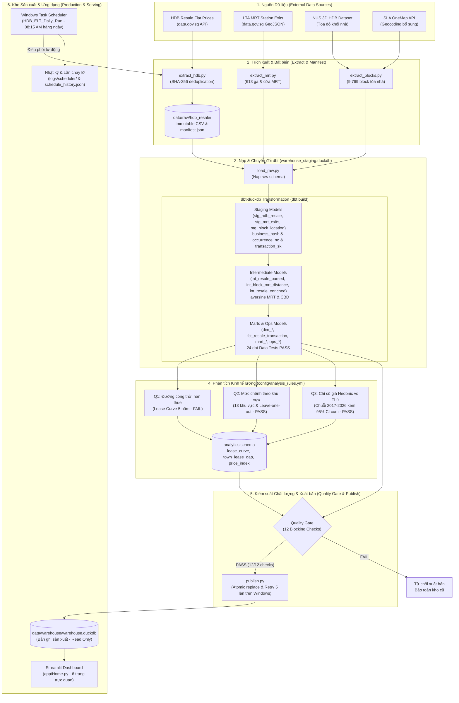

# Căn hộ có hạn dùng: Giá HDB Singapore thay đổi thế nào khi thời hạn thuê còn lại ngắn đi?

Dự án môn Trực quan hóa Dữ liệu (DS608 / Data Visualization), bao gồm hệ thống ELT định kỳ và dashboard phân tích giá bán lại căn hộ Housing & Development Board (HDB) tại Singapore dựa trên thời hạn thuê còn lại (remaining lease).

---

## 1. Giới thiệu và Mục tiêu

Căn hộ HDB tại Singapore có thời hạn thuê 99 năm. Người mua không chỉ mua diện tích và vị trí, mà còn mua số năm còn lại của hợp đồng thuê. Hệ thống này giải quyết bài toán:
- Tự động trích xuất dữ liệu bán lại chính thức từ data.gov.sg (Jan 2017 - nay) và dữ liệu địa lý (MRT, OneMap, NUS 3D).
- Lưu trữ raw snapshot bất biến và kiểm soát chất lượng dữ liệu (Quality Gate).
- Chuyển đổi dữ liệu có cấu trúc qua dbt (staging, intermediate, marts).
- Phân tích hồi quy hedonic kiểm soát đặc điểm căn hộ (diện tích, tầng, khu vực, thời điểm giao dịch) với sai số gom cụm theo block.
- Trực quan hóa toàn diện trên Streamlit dashboard.

---

## 2. Kiến trúc Hệ thống (System Architecture)

Hệ thống được thiết kế theo mô hình **Batch ELT hiện đại (Extract - Load - Transform)**, kết hợp kiểm soát chất lượng nghiêm ngặt (Quality Gate) và xuất bản nguyên tử (Atomic Publish) để đảm bảo độ tin cậy của kho dữ liệu phục vụ ứng dụng Dashboard:



### Các thành phần cốt lõi:
1. **Extract & Immutability:** Trích xuất từ 4 nguồn chính thống (API HDB, LTA MRT, NUS 3D, OneMap SLA). Lưu trữ tệp raw CSV bất biến kèm `manifest.json` và cơ chế chống nhân bản dựa trên SHA-256 (`status: no_change`).
2. **Load & dbt Transformation:** Nạp raw vào `warehouse_staging.duckdb`. dbt thực thi quy trình chuyển đổi 3 lớp (Staging $\rightarrow$ Intermediate $\rightarrow$ Marts & Ops). Tự động tính toán định danh duy nhất `transaction_sk` (kết hợp `business_hash` và `occurrence_no` bảo toàn 100% dòng trùng gốc) và cự ly Haversine tới 613 cửa MRT và CBD.
3. **Econometric Analysis:** Mô hình định giá Hedonic cố định theo quy tắc đã khóa `config/analysis_rules.yml` (SHA-256 xác thực), lưu trữ kết quả phân tích (Q1, Q2, Q3) vào schema `analytics`.
4. **Quality Gate & Atomic Publish:** Thực thi 12 quy tắc kiểm tra nghiêm ngặt (chặn xuất bản nếu thiếu cột, file rỗng, số dòng sụt giảm > 1%, hoặc null trường cốt lõi). Xuất bản nguyên tử qua cơ chế thay thế tệp kèm retry 5 lần chống lỗi khóa tệp trên Windows.
5. **Serving & Automation:** Kho dữ liệu sản xuất `warehouse.duckdb` phục vụ Streamlit Dashboard 6 màn hình chuyên đề (chế độ Read-Only). Tự động hóa lịch chạy định kỳ hằng ngày lúc 08:15 AM qua Windows Task Scheduler (`\HDB_ELT_Daily_Run`) với nhật ký độc lập và phát hiện lần chạy lỡ.

---

## 3. Cấu trúc thư mục

```text
hdb_elt/
├── README.md                 # Hướng dẫn dự án
├── requirements.txt          # Thư viện phụ thuộc
├── .env.example              # Mẫu cấu hình môi trường
├── .gitignore                # Loại trừ file nhạy cảm và dữ liệu sinh ra
├── config/
│   ├── settings.yml          # Cấu hình tham số hệ thống
│   └── analysis_rules.yml    # Quy tắc phân tích khóa cứng (kèm SHA-256)
├── data/
│   ├── raw/                  # Dữ liệu thô bất biến theo lần chạy (không commit)
│   ├── reference/            # Tọa độ block và cửa ga MRT
│   └── warehouse/            # Cơ sở dữ liệu DuckDB (không commit)
├── pipeline/
│   ├── extract_hdb.py        # Tải HDB resale từ data.gov.sg
│   ├── extract_mrt.py        # Tải MRT station exits GeoJSON
│   ├── extract_blocks.py     # Tra cứu bổ sung tọa độ OneMap
│   ├── load_raw.py           # Nạp snapshot vào DuckDB raw schema
│   ├── quality_gate.py       # Kiểm tra chất lượng dữ liệu trước khi publish
│   ├── publish.py            # Chuyển đổi nguyên tử sang warehouse chính thức
│   ├── run_pipeline.py       # Điều phối pipeline ELT toàn trình
│   └── common/               # Hàm dùng chung: retry, manifest, logger
├── dbt_hdb/                  # Dự án dbt-duckdb
│   ├── dbt_project.yml
│   ├── profiles.yml
│   └── models/
├── analysis/                 # Mô hình phân tích thống kê (Q1, Q2, Q3)
├── app/                      # Streamlit dashboard
├── tests/                    # Unit tests & quality gate tests
├── docs/                     # Tài liệu tiến độ, quyết định, từ điển dữ liệu
└── report/                   # Báo cáo tổng kết dự án
```

---

## 4. Cài đặt và Chạy hệ thống

### Yêu cầu tiên quyết
- Python 3.11 hoặc 3.12 trên hệ điều hành Windows / Linux / macOS.
- Kết nối Internet trực tiếp (không sử dụng proxy / VPN).

### Các bước thực hiện

1. **Cài đặt thư viện:**
   ```powershell
   pip install -r requirements.txt
   ```

2. **Chạy pipeline toàn trình (Thủ công):**
   ```powershell
   python pipeline/run_pipeline.py
   ```
   Lệnh trên sẽ tự động:
   - Tải snapshot HDB resale mới nhất và lưu manifest.
   - Cập nhật tọa độ MRT và block.
   - Nạp dữ liệu vào `warehouse_staging.duckdb`.
   - Thực thi các mô hình transform bằng dbt (`dbt build` - 24 tests PASS).
   - Chạy các mô hình phân tích kinh tế lượng (lease curve, town gap, price index).
   - Kiểm tra ngưỡng chất lượng dữ liệu (Quality Gate - 12 blocking checks).
   - Publish nguyên tử sang `warehouse.duckdb`.

3. **Chạy kiểm thử chất lượng và hồi quy:**
   ```powershell
   pytest -v
   ```

4. **Khởi chạy Dashboard trực quan hóa:**
   ```powershell
   streamlit run app/Home.py
   ```

5. **Đăng ký Lịch chạy Tự động hằng ngày (Windows Task Scheduler):**
   ```powershell
   powershell.exe -ExecutionPolicy Bypass -File scripts/register_task.ps1
   ```
   Tác vụ `\HDB_ELT_Daily_Run` sẽ tự động kích hoạt vào lúc **08:15 AM hằng ngày**, lưu log riêng biệt theo dấu thời gian vào `logs/scheduler/run_YYYYMMDD_HHMMSS.log` và theo dõi lần chạy lỡ tại `logs/scheduler/schedule_history.json`.

---

## 5. Nguồn dữ liệu và Bản quyền

- **HDB Resale Flat Prices:** Data.gov.sg (Housing & Development Board), giấy phép Singapore Open Data Licence version 1.0.
- **LTA MRT Station Exits:** Data.gov.sg (Land Transport Authority), giấy phép Singapore Open Data Licence version 1.0.
- **NUS 3D HDB Dataset:** NUS Urban Analytics Lab (Biljecki, 2020), giấy phép MIT.
- **OneMap Search API:** Singapore Land Authority (SLA).

---

## 6. Giới hạn bắt buộc

- Dữ liệu dựa trên giao dịch mua bán đã đăng ký hoàn tất, không phản ánh toàn bộ cung/cầu thị trường.
- Khoảng cách đến MRT và CBD tính theo đường thẳng (Haversine), không phải khoảng cách đi bộ thực tế.
- Mạng lưới MRT áp dụng là mạng lưới hiện hành, không phản ánh động lịch sử mở ga mới.
- Kết quả thống kê chỉ thể hiện mối tương quan có điều kiện (conditional correlation), không hàm ý quan hệ nhân quả.
- Dự án không cung cấp khuyến nghị đầu tư hoặc định giá căn hộ cá lẻ.

