<div align="center">

# Căn hộ có hạn dùng

### Hệ thống ELT và dashboard trực quan hóa mối liên hệ giữa thời hạn thuê còn lại và giá căn hộ HDB Singapore

Bài tập lớn môn **Trực quan hóa dữ liệu**


[Kết quả chính](#kết-quả-chính) · [Câu chuyện dữ liệu](#câu-chuyện-dữ-liệu) · [Dashboard](#dashboard) · [Kiến trúc](#kiến-trúc) · [Cài đặt](#cài-đặt-và-chạy) · [Báo cáo](#tài-liệu)

</div>

---

## Tổng quan

Căn hộ HDB ở Singapore được bán với hợp đồng thuê 99 năm. Người mua căn bán lại không chỉ mua diện tích và vị trí, mà còn mua **số năm thuê còn lại**. Giá trung vị thô rất dễ gây hiểu nhầm, vì loại căn, khu và tuổi căn được bán khác nhau giữa các nhóm thời hạn và thay đổi theo thời gian.

Dự án gồm ba phần:

- **Pipeline ELT tự động:** tải dữ liệu chính thức từ data.gov.sg, lưu dữ liệu thô bất biến, biến đổi bằng dbt trên DuckDB, chặn publish khi không đạt kiểm tra chất lượng.
- **Phân tích:** so sánh các căn tương tự bằng mô hình hedonic, với sai số gom theo block và quy tắc phân tích khóa trước khi chạy.
- **Trực quan hóa:** notebook Pandas tạo toàn bộ hình cho báo cáo, và dashboard Streamlit 6 trang, mỗi trang trả lời một câu hỏi.

**Dữ liệu sử dụng:** 244.426 giao dịch bán lại, từ 01/2017 đến 11/2026 (lần tải ngày 11/11/2026).

> Dự án mô tả giao dịch đã đăng ký. Dự án không dự báo giá, không định giá căn cụ thể, không xếp hạng khu "đáng mua" và không đưa ra kết luận nhân quả.

---

## Câu hỏi phân tích

| Mã | Câu hỏi | Quyết định hỗ trợ |
|:-:|---|---|
| **Q1** | Khi so sánh các căn tương tự (cùng diện tích, tầng, loại căn, khu và tháng giao dịch), giá chênh bao nhiêu theo từng nhóm thời hạn thuê còn lại so với nhóm 70–74 năm? Mức chênh có ổn định giữa 2017–2022 và 2023–nay không? | Hiểu vai trò của thời hạn thuê trong giá |
| **Q2** | Mức chênh giữa căn còn 55–65 năm và căn còn 70–80 năm có khác nhau giữa các khu không? Thứ tự các khu có giữ được giữa hai giai đoạn không? | Biết khu nào cần xem kỹ yếu tố thời hạn |
| **Q3** | Từ 2019 đến 2025, giá trung vị thô tăng khác thế nào so với chỉ số giá đã kiểm soát đặc điểm căn? | Đọc đúng mức tăng giá thị trường |
| **Q4** | Với ngân sách, loại căn, thời hạn tối thiểu và khoảng cách MRT cho trước, khu nào có giao dịch phù hợp trong 12 tháng gần nhất, và bao nhiêu giao dịch? | Thu hẹp khu cần tìm hiểu |

---

## Kết quả chính

| | Phát hiện | Tiêu chí đặt trước |
|:-:|---|:-:|
| **Q1** | Giá/m² thô có **dạng chữ U**: nhóm 80–84 năm rẻ nhất (4.329 SGD/m²), còn nhóm dưới 50 năm đắt hơn (5.439 SGD/m²). Khi so sánh căn tương tự, kết quả ngược lại: nhóm thời hạn ngắn hơn có giá thấp hơn ở cả hai giai đoạn. Căn còn dưới 50 năm thấp hơn căn còn 70–74 năm khoảng 27–28%. | ❌ **Chưa đạt**: nhóm 80–84 năm lệch 0,0831 log points (9,43 điểm %), ngưỡng 0,05 |
| **Q2** | Mức chênh khác rõ giữa 13 khu, từ +1,24% (Tampines) đến −23,99% (Ang Mo Kio). Thứ tự các khu chỉ giữ được một phần giữa hai giai đoạn. | ⚠️ **Đạt sát ngưỡng**: Spearman 0,6209 (ngưỡng 0,60); 6/13 lần bỏ một khu thì rơi dưới 0,60 |
| **Q3** | Từ 2019 đến 2025, giá thô tăng **+57,00%**, chỉ số đã kiểm soát tăng **+58,87%**. Giai đoạn 2020–2022 giá thô cao hơn chỉ số đã kiểm soát; từ 2023 chiều đảo ngược. | ✅ **Đạt** |
| **Q4** | Với bộ lọc ví dụ (4 ROOM, 450–650 nghìn SGD, ≥ 60 năm, < 800 m tới MRT): 14 khu, 2.894 giao dịch. Kết quả sắp theo tên khu, không xếp hạng. | ✅ **Hoạt động** |

---

## Câu chuyện dữ liệu

Phần này đi theo mạch kể chuyện của báo cáo: **giá thô gợi ý một điều → bảng cơ cấu cho thấy vì sao → so sánh căn tương tự cho kết luận khác.** Toàn bộ hình được tạo bằng [`notebooks/eda_pandas.ipynb`](notebooks/eda_pandas.ipynb).

### 1. Bối cảnh thị trường

<table>
<tr>
<td width="50%">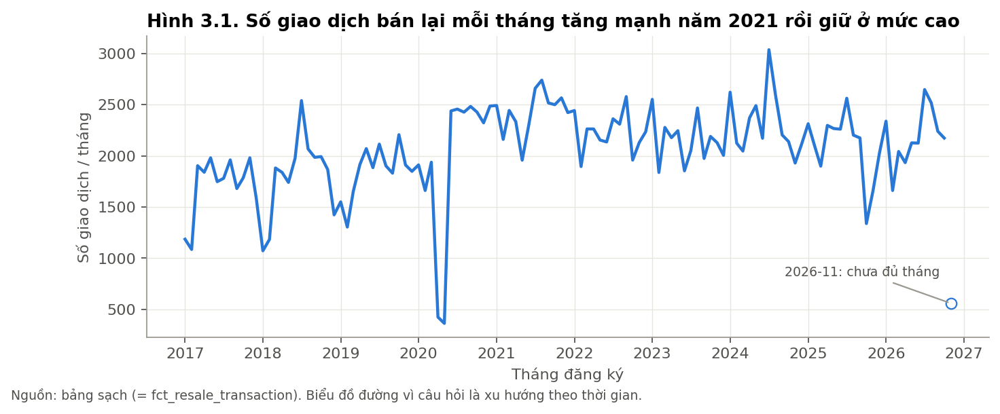</td>
<td width="50%">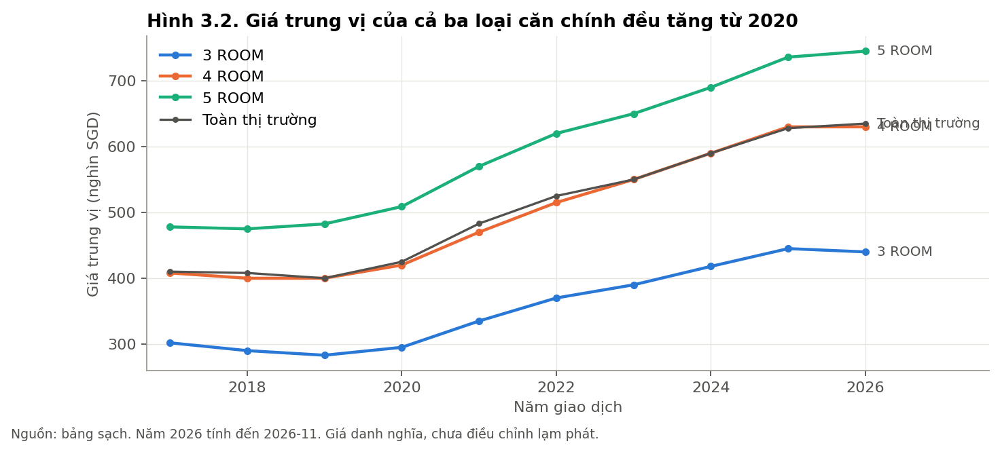</td>
</tr>
<tr>
<td>Số giao dịch thấp nhất vào 05/2020 (363) và cao nhất vào 07/2024 (3.036).</td>
<td>Giá trung vị toàn thị trường tăng từ 400.000 SGD (2019) lên 628.000 SGD (2025).</td>
</tr>
<tr>
<td width="50%">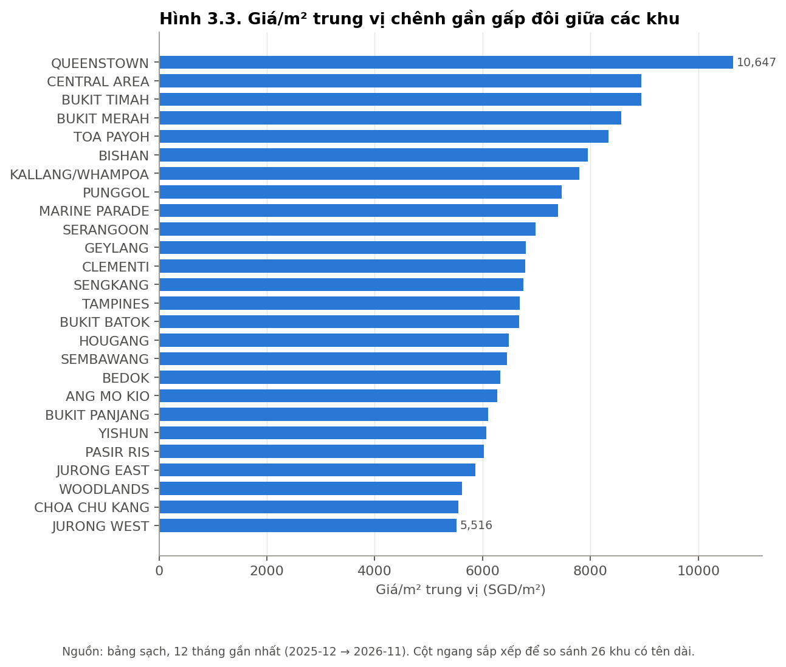</td>
<td width="50%">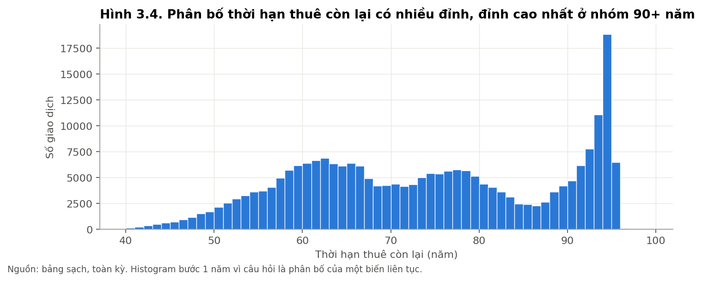</td>
</tr>
<tr>
<td>Trong 12 tháng gần nhất, giá/m² chênh khoảng 1,93 lần giữa Jurong West và Queenstown.</td>
<td>Phân bố thời hạn còn lại có nhiều đỉnh; trung vị là 73,8 năm.</td>
</tr>
</table>

### 2. Bước 1: giá thô kể sai câu chuyện

<p align="center">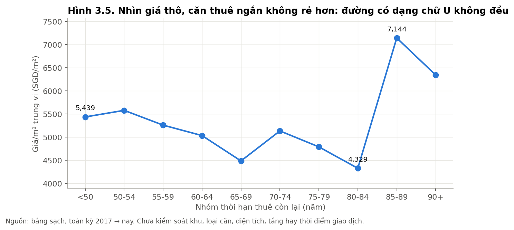</p>

Nhìn giá thô, căn còn ít năm thuê **không rẻ hơn**. Nhóm 80–84 năm có giá/m² thấp nhất, còn nhóm 85–89 năm tăng vọt.

<p align="center">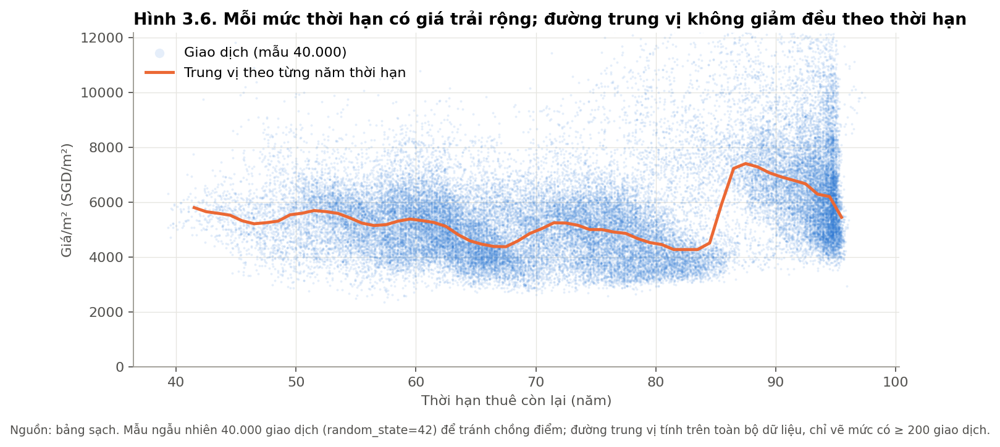</p>

### 3. Bước 2: vì sao lại như vậy

Mỗi nhóm thời hạn là một "giỏ" căn khác nhau:

| Nhóm | % khu Mature | Cách CBD TB | % 3 ROOM | % 5 ROOM + EXEC | Diện tích TB | Giá/m² trung vị |
|---|--:|--:|--:|--:|--:|--:|
| < 50 năm | 94,3% | 6,2 km | 79,7% | 3,6% | 66,7 m² | 5.438 |
| 80–84 năm | 21,7% | 13,3 km | 1,8% | 55,4% | 104,0 m² | 4.329 |
| 90+ năm | 24,4% | 13,2 km | 18,0% | 20,9% | 89,7 m² | 6.344 |

Căn thuê ngắn tập trung ở khu cũ gần trung tâm và chủ yếu là căn nhỏ. Căn còn 80–84 năm nằm xa trung tâm hơn và phần lớn là căn lớn. Nhóm 90+ lẫn căn mới: 36.487 giao dịch (66,2% của nhóm) là căn còn 93–96 năm. Biểu đồ thô vì thế đang so sánh **những giỏ căn khác nhau**.

### 4. Bước 3: so sánh căn tương tự

<p align="center">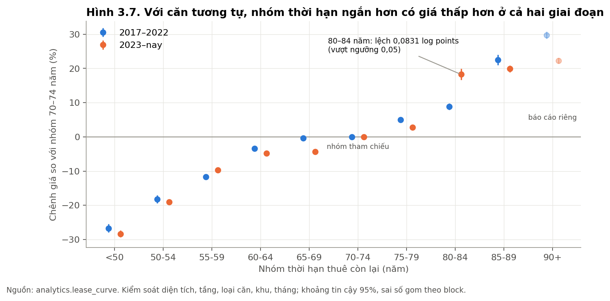</p>

Mô hình kiểm soát diện tích, tầng, loại căn, khu và tháng. Kết quả: hệ số tăng dần theo thời hạn ở **cả hai giai đoạn**, và thứ tự các nhóm giống hệt nhau giữa hai giai đoạn (Spearman = 1,0). Riêng nhóm 80–84 năm thay đổi vượt ngưỡng đặt trước, nên Q1 được ghi nhận là chưa đạt; nguyên nhân chưa xác định.

### 5. Khác biệt theo khu (Q2)

<table>
<tr>
<td width="55%">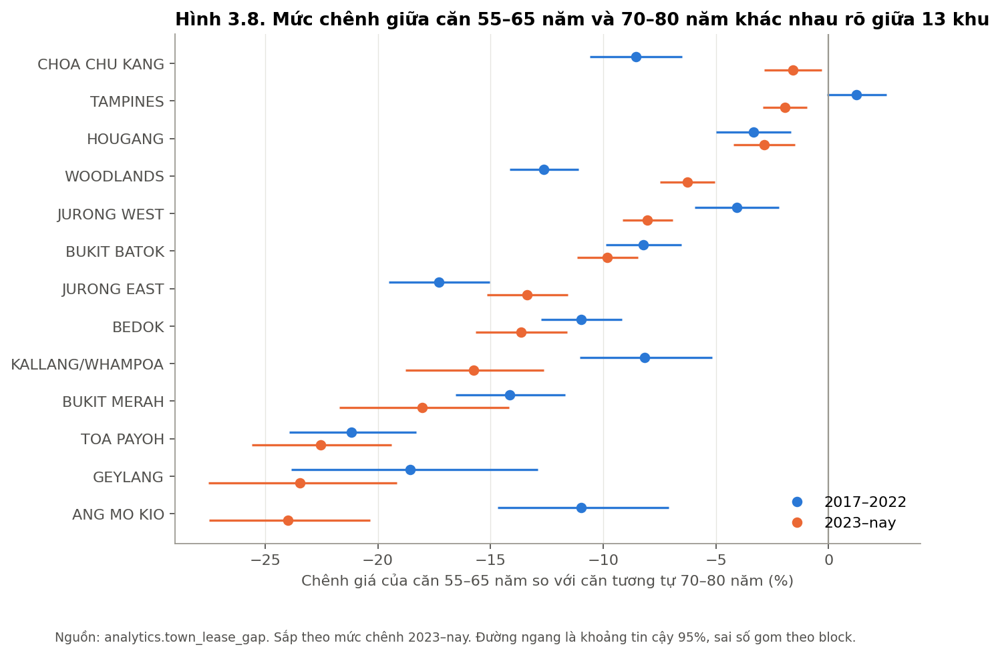</td>
<td width="45%">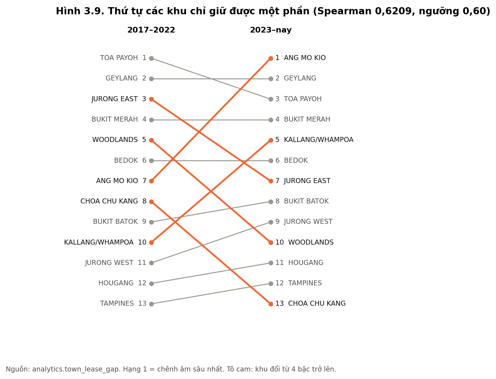</td>
</tr>
<tr>
<td>Biểu đồ điểm có khoảng tin cậy 95%: mức chênh là số âm, nên so <b>vị trí</b> thay vì độ dài cột.</td>
<td>Slope chart: 5 khu đổi từ 4 bậc trở lên giữa hai giai đoạn.</td>
</tr>
</table>

### 6. Giá thô và chỉ số đã kiểm soát (Q3)

<table>
<tr>
<td width="55%">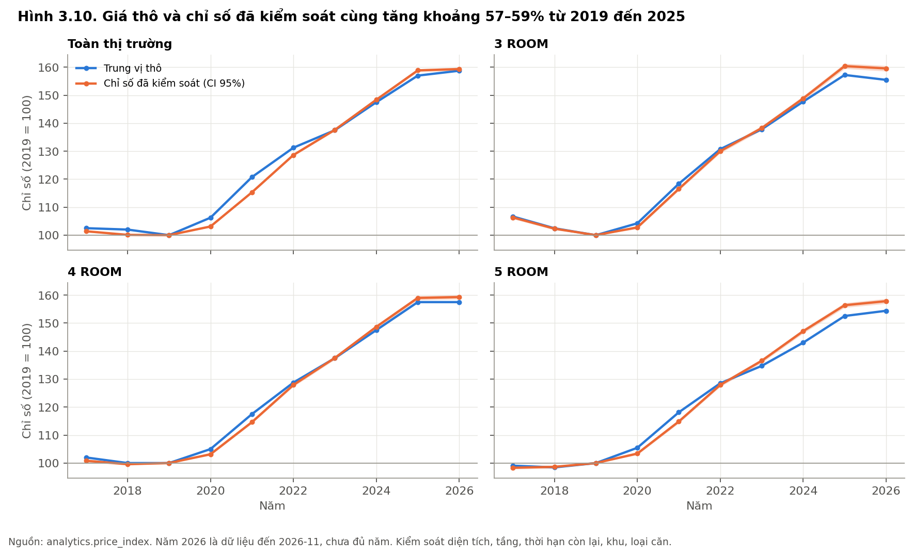</td>
<td width="45%">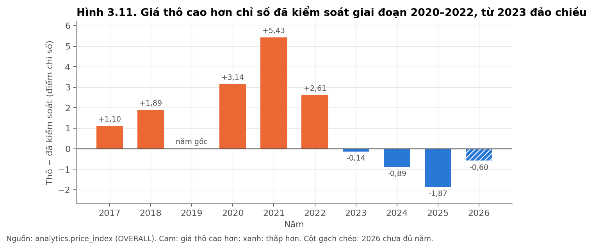</td>
</tr>
<tr>
<td>Hai chỉ số đưa về cùng gốc 2019 = 100 trên <b>một trục</b>, không dùng hai trục y.</td>
<td>Giá thô cao hơn trong 2020–2022, thấp hơn từ 2023. Diễn biến này diễn ra cùng lúc với thay đổi cơ cấu giao dịch; dữ liệu chưa chứng minh nguyên nhân.</td>
</tr>
</table>

### 7. Bản đồ giá theo khu vực

<p align="center">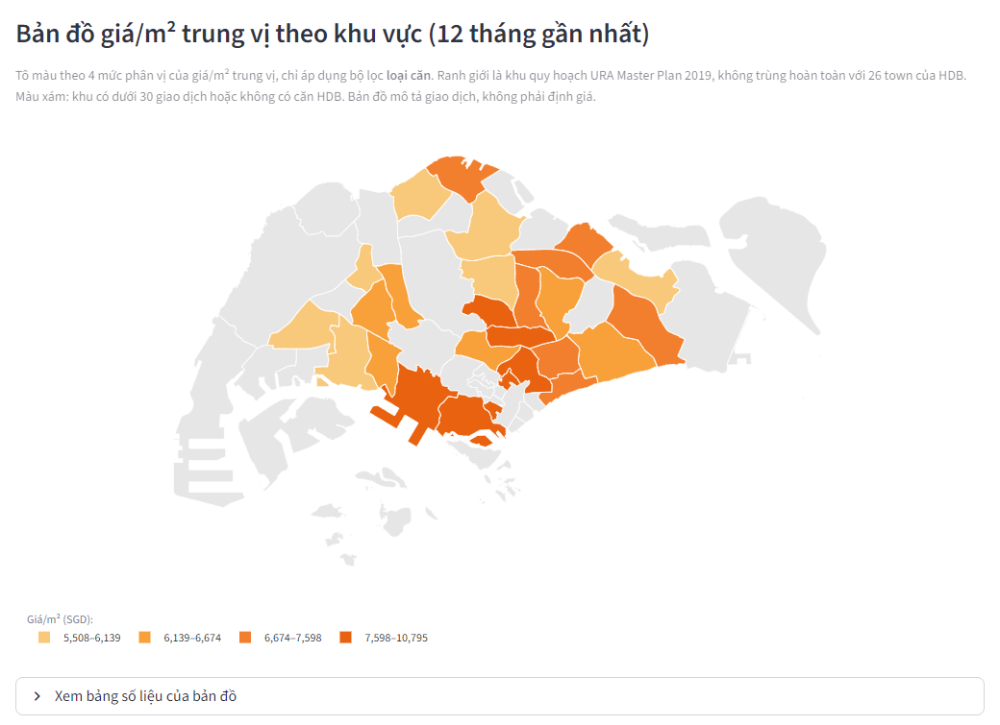</p>

Bản đồ tô giá/m² trung vị 12 tháng gần nhất theo khu quy hoạch URA 2019 (3 ROOM và 4 ROOM). Khu có dưới 30 giao dịch được tô xám.

---

## Dashboard

Dashboard Streamlit gồm 6 trang và chỉ đọc kho `warehouse.duckdb`. Mỗi trang trả lời một câu hỏi, ghi tháng dữ liệu mới nhất, và có hai khung **"Quyết định hỗ trợ"** và **"Giới hạn"**. Bấm vào ảnh để xem toàn trang.

<table>
<tr>
<td width="50%" align="center"><a href="report/figures/dash_1_tong_quan.png">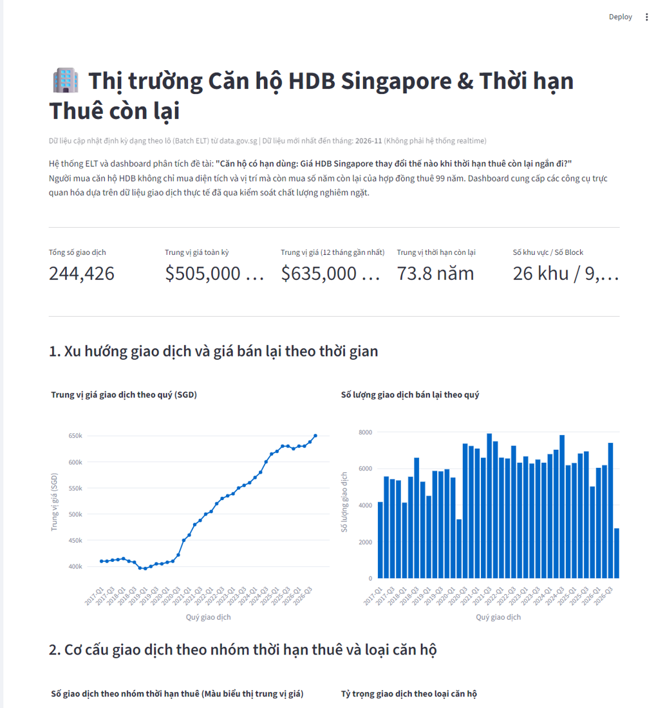</a><br><b>Tổng quan</b>: thẻ chỉ số, xu hướng, phân bố</td>
<td width="50%" align="center"><a href="report/figures/dash_2_duong_cong_thue.png">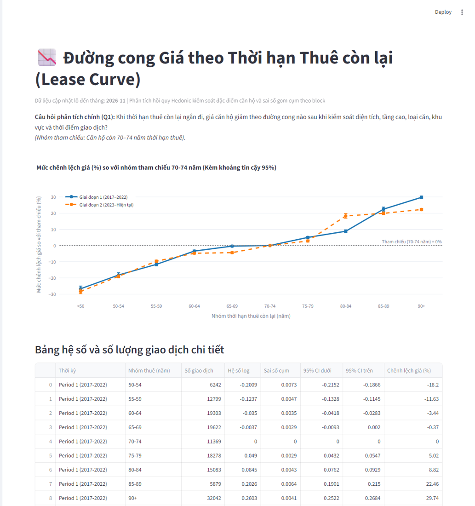</a><br><b>Đường cong thuê (Q1)</b>: hệ số và khoảng tin cậy hai giai đoạn</td>
</tr>
<tr>
<td align="center"><a href="report/figures/dash_3_so_sanh_khu.png">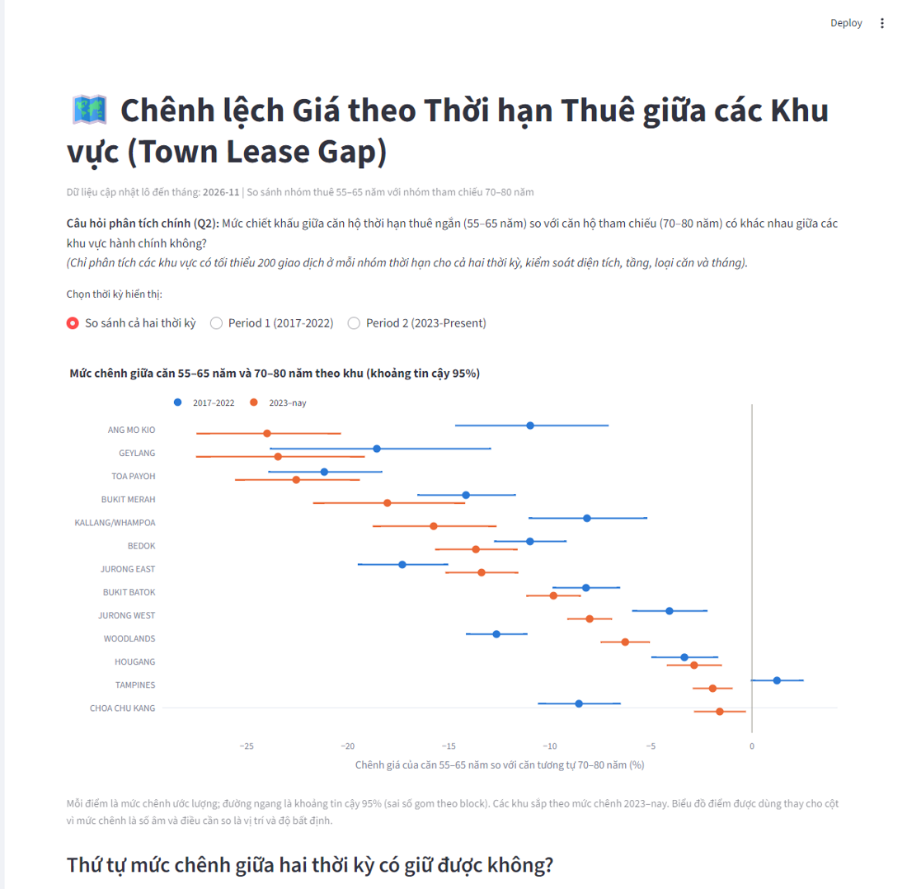</a><br><b>So sánh khu (Q2)</b>: biểu đồ điểm, slope chart, kiểm tra bỏ từng khu</td>
<td align="center"><a href="report/figures/dash_4_gia_dieu_chinh.png">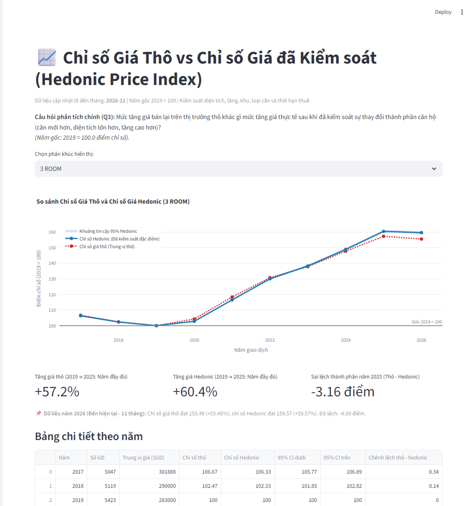</a><br><b>Giá đã điều chỉnh (Q3)</b>: hai chỉ số trên một trục</td>
</tr>
<tr>
<td align="center"><a href="report/figures/dash_5_tim_khu.png">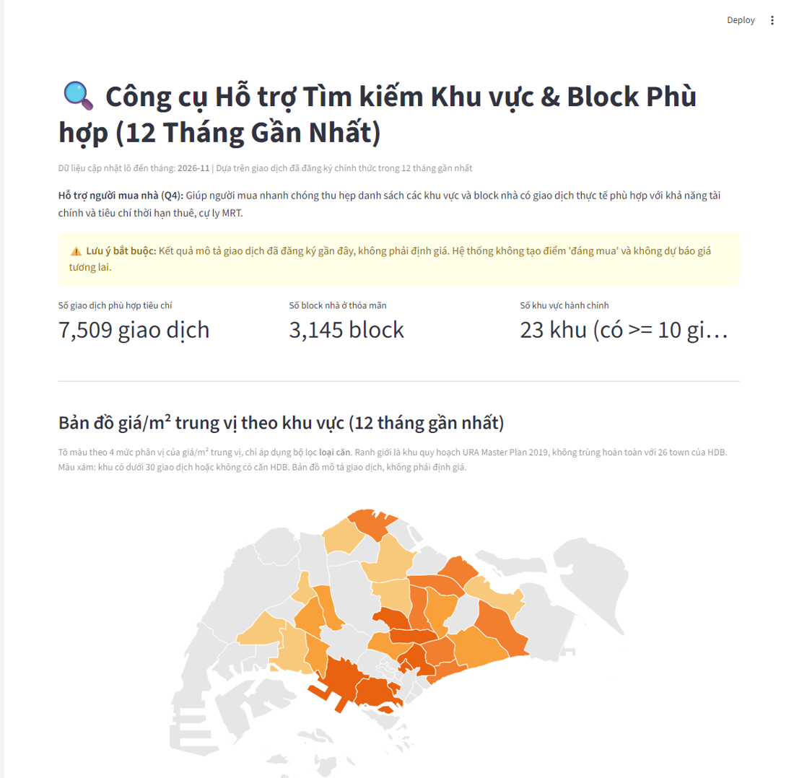</a><br><b>Tìm khu (Q4)</b>: bộ lọc, bản đồ, bảng theo tên khu, cảnh báo bắt buộc</td>
<td align="center"><a href="report/figures/dash_6_van_hanh.png">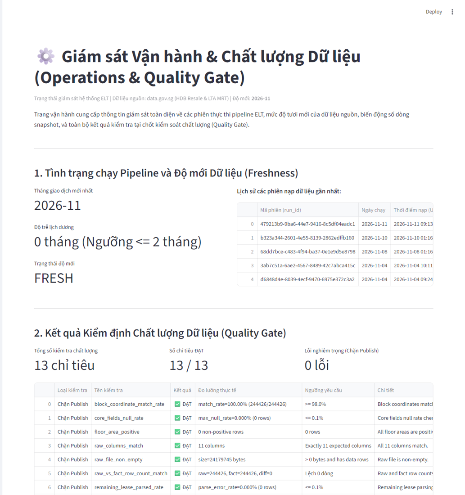</a><br><b>Vận hành</b>: lịch sử nạp, độ mới, quality gate</td>
</tr>
</table>

**Nguyên tắc thiết kế:**

- So sánh bằng **vị trí trên cùng một trục** (Cleveland & McGill, 1984).
- Luôn hiện **khoảng tin cậy 95%** cho các ước lượng.
- Màu nhất quán: xanh là 2017–2022 hoặc giá thô, cam là 2023–nay hoặc giá đã kiểm soát. Nhiều chuỗi luôn có chú giải hoặc nhãn trực tiếp.
- Không dùng biểu đồ hai trục y; không có điểm "đáng mua"; danh sách khu sắp theo tên.

---

## Kiến trúc

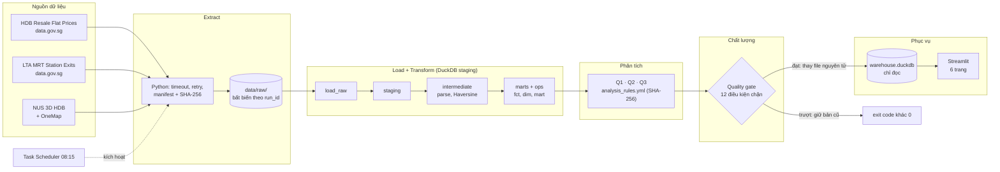

| Lớp | Công nghệ | Điểm chính |
|---|---|---|
| Extract | Python, Requests | API `initiate-download` → `poll-download`; timeout 60 giây; thử lại 3 lần có giãn cách; không thử lại khi gặp 403 |
| Lưu thô | Thư mục cục bộ | Mỗi lần chạy một thư mục kèm `manifest.json` (số dòng, cột, SHA-256); dữ liệu không đổi thì ghi `no_change` |
| Transform | dbt-duckdb | 16 mô hình, 24 kiểm thử; khóa `transaction_sk = sha256(business_hash ‖ occurrence_no)` giữ đúng 318 dòng trùng của nguồn |
| Phân tích | statsmodels | Mô hình hedonic, sai số gom theo block; quy tắc khóa trong `config/analysis_rules.yml` |
| Chất lượng | Python | 12 điều kiện chặn publish và 1 chỉ số cảnh báo; publish bằng cách thay file nguyên tử |
| Phục vụ | Streamlit, Plotly | Chỉ đọc; bản đồ choropleth theo khu quy hoạch URA 2019 |
| Vận hành | Windows Task Scheduler | Mỗi lần chạy ghi trạng thái vào `logs/scheduler/pipeline_runs.json`, kể cả khi lỗi hoặc bị ngắt |

---

## Chất lượng dữ liệu và kiểm thử

| Hạng mục | Kết quả |
|---|---|
| Ô thiếu, sai kiểu, giá hoặc diện tích ≤ 0 | 0 |
| Lỗi parse thời hạn còn lại và khoảng tầng | 0 |
| Tỷ lệ ghép tọa độ block | 100,00% (244.426/244.426) |
| Dòng trùng hoàn toàn | 318 (0,13%), được giữ lại và đánh số `occurrence_no` |
| Đối chiếu Pandas với dbt | Khớp từng dòng; sai lệch lớn nhất bằng 0 |
| Quality gate | 12/12 điều kiện chặn đạt |
| dbt test | 24/24 đạt |
| pytest | 19/19 đạt (parser, manifest, quality gate, publish khi file bị khóa, đối chiếu 20 dòng với CSV gốc, ghi trạng thái lần chạy) |

---

## Cài đặt và chạy

**Yêu cầu:** Python 3.11 trở lên, có kết nối Internet. Lịch chạy tự động dùng Windows Task Scheduler.

```powershell
# 1. Cài thư viện
pip install -r requirements.txt

# 2. Chạy toàn bộ pipeline: tải → nạp → dbt → phân tích → quality gate → publish
python pipeline/run_pipeline.py

# 3. Kiểm thử
pytest -q
cd dbt_hdb; dbt test --profiles-dir .; cd ..

# 4. Tạo lại toàn bộ hình và số liệu của báo cáo (ghi vào report/figures/)
python -m nbconvert --to notebook --execute --inplace notebooks/eda_pandas.ipynb

# 5. Mở dashboard
streamlit run app/Home.py

# 6. (Tùy chọn) Đăng ký lịch chạy hằng ngày lúc 08:15
powershell.exe -ExecutionPolicy Bypass -File scripts/register_task.ps1
```

> **Trạng thái vận hành:** tính đến 16/11/2026 mới ghi nhận 1 lần chạy theo lịch thành công (tiêu chí là 7 lần). Phần lớn các lần bị lỡ là do máy đang tắt lúc 08:15. Cấu hình Task Scheduler đề xuất (chạy bù khi máy bật lại, giới hạn thời gian chạy 30 phút) được mô tả ở mục 4.3 của báo cáo và chưa được áp dụng.

---

## Cấu trúc thư mục

```text
hdb_elt/
├── pipeline/                 # Extract, load, quality gate, publish, điều phối
│   ├── run_pipeline.py       # Chạy 8 bước, ghi trạng thái mọi lần chạy
│   └── common/               # retry, manifest, logger, run_history
├── dbt_hdb/models/           # staging → intermediate → marts → ops
├── analysis/                 # Q1 lease_curve, Q2 town_lease_gap, Q3 price_index
├── config/                   # settings.yml, analysis_rules.yml (+ SHA-256)
├── app/                      # Streamlit: Home.py, pages/, heatmap.py, mrt_names.py
├── notebooks/eda_pandas.ipynb# Làm sạch bằng Pandas, đối chiếu dbt, vẽ hình báo cáo
├── report/                   # report.md, report.docx, figures/
├── tests/                    # pytest
├── scripts/                  # run_pipeline.ps1, register_task.ps1, check_sources.py
├── docs/                     # runbook, từ điển dữ liệu, quyết định, ảnh README
└── data/                     # raw/ và warehouse/ không commit; reference/ là bảng tra cứu
```

---

## Tài liệu

| Tài liệu | Nội dung |
|---|---|
| [`report/report.md`](report/report.md) · `report/report.docx` | Báo cáo đầy đủ: 4 chương, phụ lục nghiệm thu và kiểm thử |
| [`notebooks/eda_pandas.ipynb`](notebooks/eda_pandas.ipynb) | Làm sạch bằng Pandas, đối chiếu với dbt, toàn bộ hình |
| [`docs/data_dictionary.md`](docs/data_dictionary.md) | Từ điển dữ liệu |
| [`docs/decisions.md`](docs/decisions.md) | Nhật ký quyết định (vì sao giữ kết quả Q1 chưa đạt) |
| [`docs/runbook.md`](docs/runbook.md) | Hướng dẫn vận hành |
| [`HDB_ELT_PROJECT_SPEC.md`](HDB_ELT_PROJECT_SPEC.md) | Đặc tả dự án |

---

## Nguồn dữ liệu và giấy phép

| Nguồn | Đơn vị | Giấy phép |
|---|---|---|
| Resale flat prices (từ 01/2017) | Housing & Development Board, data.gov.sg | Singapore Open Data Licence |
| LTA MRT Station Exit | Land Transport Authority, data.gov.sg | Singapore Open Data Licence |
| Master Plan 2019 Planning Area Boundary | Urban Redevelopment Authority, data.gov.sg | Singapore Open Data Licence |
| hdb3d-data (tọa độ block) | NUS Urban Analytics Lab | MIT |
| OneMap Search API | Singapore Land Authority | Điều khoản sử dụng OneMap |

Biljecki, F. (2020). Exploration of open data in Southeast Asia to generate 3D building models. *ISPRS Annals of the Photogrammetry, Remote Sensing and Spatial Information Sciences*, VI-4/W1-2020, 37–44.

---

## Giới hạn

- Dữ liệu là giao dịch đã đăng ký, theo tháng; không có vị trí căn chính xác.
- Giá danh nghĩa, chưa điều chỉnh lạm phát.
- Thời hạn thuê gắn với tuổi và chất lượng căn, là những yếu tố mô hình không quan sát được.
- Khoảng cách tính theo đường thẳng; mạng MRT là mạng hiện tại.
- Kết quả là mối liên hệ có điều kiện, không phải quan hệ nhân quả.
- Q2 nhạy với việc chọn khu.
- Không phải tư vấn tài chính hay định giá.
